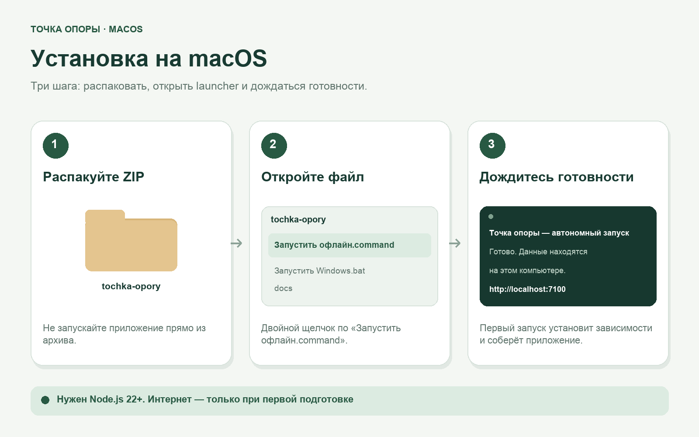
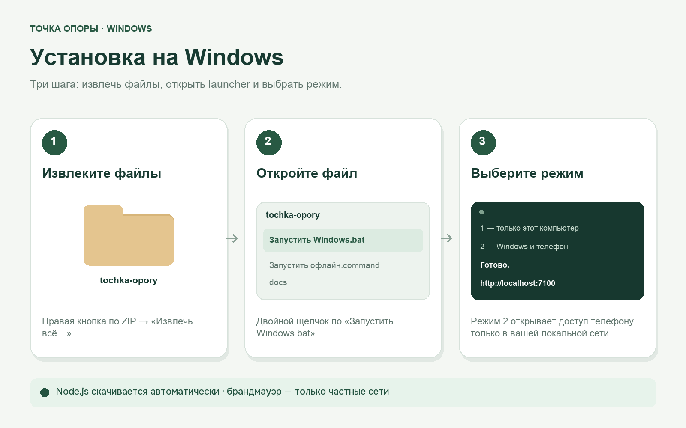

# Точка опоры

**Деньги, настроение и заметки — локально, без подписки и облака.**

Приложение с открытым исходным кодом для macOS и Windows. Телефон подключается через браузер и работает с той же базой на компьютере.

[](LICENSE)
[](https://nodejs.org/)
[](https://github.com/gankata/tochka-opory/releases)

## Скачать

**[Скачать последнюю версию для macOS и Windows (.zip)](https://github.com/gankata/tochka-opory/releases/latest/download/tochka-opory.zip)**

Ссылка всегда ведёт на свежий релиз. Git и терминал для обычного использования не нужны.


## Возможности

| Раздел | Что можно делать |
| --- | --- |
| **Деньги** | Учитывать доходы, расходы и валюты, настраивать одну или две выплаты либо доход по факту, планировать платежи, импортировать CSV/OFX |
| **Аналитика** | Смотреть динамику и прогноз в рублях, отмечать даты выплат без предположения суммы и сохранять представления фильтров |
| **Настроение** | Вести дневник состояния, эмоций, сна и энергии, фильтровать записи по дате и теме и быстро возвращаться ко всем дням |
| **Заметки** | Создавать дерево страниц, вишлисты, изображения и связи `[[между заметками]]` |
| **Капитал** | Записывать активы и обязательства, отслеживать чистый капитал |
| **Данные** | Экспортировать Markdown/CSV/ICS/PDF, создавать резервные копии и зашифрованные архивы |

## Установка

Для первой подготовки нужен интернет. Устанавливать Node.js заранее не обязательно: если совместимой версии нет, launcher скачает официальный Node.js 22 в папку `.toolchain` внутри приложения, проверит SHA-256 и использует его без установки в систему и прав администратора. Затем он сам выполнит `npm ci` и сборку. Последующие запуски и внесение данных работают без интернета.

<details>
<summary><strong>macOS — установка с иллюстрацией</strong></summary>



1. Распакуйте скачанный ZIP.
2. Откройте `Запустить офлайн.command` двойным щелчком.
3. Дождитесь сообщения «Готово» и откройте `http://localhost:7100`.

[Подробная инструкция для macOS](docs/INSTALL.md#macos)

</details>

<details>
<summary><strong>Windows — установка с иллюстрацией</strong></summary>



1. Нажмите по ZIP правой кнопкой и выберите «Извлечь всё…».
2. Откройте `Запустить Windows.bat` двойным щелчком.
3. Выберите режим 1 или 2 и дождитесь сообщения «Готово».

[Подробная инструкция для Windows](docs/INSTALL.md#windows)

</details>

<details>
<summary><strong>iPhone и Android — подключение к компьютеру</strong></summary>

1. Запустите приложение на компьютере в режиме **2 — компьютер и телефон**.
2. Подключите оба устройства к одной локальной Wi-Fi-сети.
3. Откройте на телефоне адрес из окна запуска, например `http://192.168.1.10:7100`.
4. Войдите с той же локальной учётной записью.

APK и отдельная мобильная база не нужны. Без запущенного компьютера работа с общими данными недоступна. Ввод операций и создание других локальных записей совместимы с LAN HTTP даже в браузерах без `crypto.randomUUID`. [Настройка телефона и работа без интернета](docs/WINDOWS-ANDROID.md).

</details>

[Установка и обновление](docs/INSTALL.md) · [Руководство по функциям с иллюстрациями](docs/GUIDE.md)

После первой регистрации можно пройти необязательное знакомство из шести карточек или пропустить его. В дальнейшем руководство доступно из меню приложения. Его иллюстрации соответствуют светлой или тёмной теме; снимок можно раскрыть, увеличить до 300 % и прокрутить, а кнопка «По размеру экрана» снова уместит его целиком. Значки вопроса рядом с функциями открывают практические инструкции по действиям и последствиям, а не повторяют видимые описания; их можно отключить в настройках. Тип и дни выплат можно менять в настройках: плановые даты перестроятся после сохранения, а фактические операции останутся без изменений. При распаковке новой версии рядом со старой однозначно найденная локальная база переносится автоматически и не перезаписывает существующие данные.

## Приватность и данные

- Личные записи хранятся только в `data/tochka-opory.db` на вашем компьютере.
- Новая установка начинается с чистой базы — без чужих операций, паролей и демонстрационных трат.
- Пароль сохраняется как scrypt-хеш; сессии используют HttpOnly-cookie и хеши токенов.
- Автоматические SQLite-копии находятся в `data/backups/`. Для защиты от отказа диска нужна дополнительная копия на другом носителе.
- Локальная сеть использует HTTP. Подключайтесь только в своей сети и не выставляйте сервер в интернет.

<details>
<summary><strong>Восстановление и сброс пароля</strong></summary>

Список доступных SQLite-копий:

```bash
npm run db:recover
```

Восстановление выбранной копии:

```bash
npm run db:recover -- <имя-файла.sqlite>
```

Сброс локального пароля через терминал в папке проекта:

```bash
npm run auth:reset
```

Перед восстановлением приложение сохраняет текущее состояние. Сброс пароля завершает старые сессии и не требует прав root.

</details>

<details>
<summary><strong>Запуск из исходного кода и проверки</strong></summary>

```bash
npm ci
npm run dev
```

Production-режим:

```bash
npm run build
npm start
```

Проверки перед публикацией:

```bash
npm run check:public
npm run lint
npm run check
npm test
npm run build
npm run check:performance
npm run check:windows
npm run test:browser
npm run test:browser:firefox
npm run test:browser:webkit
npm run test:stress
```

Браузерные сценарии проверяют Chromium, Firefox и WebKit. Нагрузочный контроль использует отдельную базу: импорт и дедупликацию 5000 операций, параллельные записи и чтения, офлайн-очередь, резервное копирование, восстановление и аварийный перезапуск.

По умолчанию production-сервер слушает `127.0.0.1`. Переменные `HOST`, `PORT`, `DATA_DIR` и `FILE_BACKUP_RETAIN` позволяют изменить адрес, порт, каталог данных и число файловых копий.

</details>

## Общение и поддержка

Основное место для разговора с пользователями и разработчиками — [GitHub Discussions](https://github.com/gankata/tochka-opory/discussions). Начните с [приветствия и правил сообщества](https://github.com/gankata/tochka-opory/discussions/1).

- [Помощь и вопросы](https://github.com/gankata/tochka-opory/discussions/categories/помощь-и-вопросы) — установка, обновление и использование.
- [Идеи и улучшения](https://github.com/gankata/tochka-opory/discussions/categories/идеи-и-улучшения) — предложения новых возможностей.
- [Опыт и настройки](https://github.com/gankata/tochka-opory/discussions/categories/опыт-и-настройки) — сценарии использования и собственные доработки.
- [Новости и релизы](https://github.com/gankata/tochka-opory/discussions/categories/новости-и-релизы) — объявления и обратная связь по версиям.

Для воспроизводимых ошибок используйте [форму сообщения об ошибке](https://github.com/gankata/tochka-opory/issues/new?template=bug_report.yml), для уязвимостей — приватный канал из [SECURITY.md](SECURITY.md). Не публикуйте базу, архивы, реальные финансовые записи, заметки, пароли и токены.

## Документация и участие

- [Руководство по функциям](docs/GUIDE.md)
- [Установка и обновление](docs/INSTALL.md)
- [Телефон и локальная сеть](docs/WINDOWS-ANDROID.md)
- [Участие в разработке](CONTRIBUTING.md)
- [Безопасность](SECURITY.md)
- [Приватность · Privacy](PRIVACY.md)
- [Ограничения ответственности · Disclaimer](DISCLAIMER.md)
- [Релизы и примечания к обновлениям](https://github.com/gankata/tochka-opory/releases)

Автор проекта — [gankata](https://github.com/gankata) · 2026.

Проект распространяется по лицензии [MIT](LICENSE).
