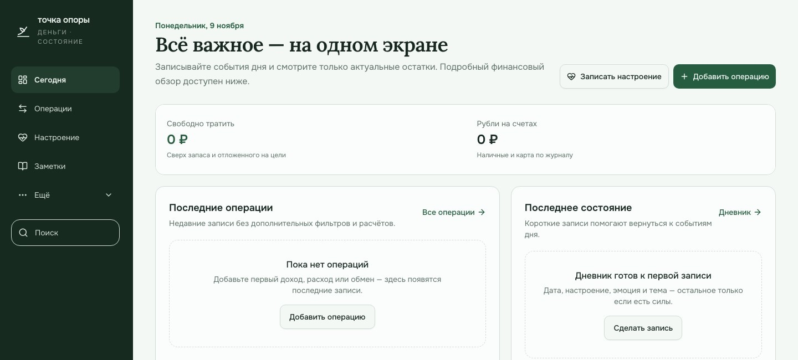

# Точка опоры

**Локальное пространство для денег, настроения и заметок — без подписки, облака и передачи личных данных.**

[](LICENSE)
[](https://nodejs.org/)
[](https://react.dev/)
[](https://www.typescriptlang.org/)

## Скачать готовый архив

**[Скачать последнюю версию для macOS и Windows (.zip)](https://github.com/gankata/tochka-opory/releases/latest/download/tochka-opory.zip)**

Git и терминал для обычного запуска не нужны:

1. Распакуйте архив в обычную папку, например «Документы/tochka-opory».
2. Пока есть интернет, установите [Node.js 22 или новее](https://nodejs.org/).
3. На Mac откройте `Запустить офлайн.command`, на Windows — `Запустить Windows.bat`.
4. При первом запуске дождитесь автоматической установки зависимостей и сборки. После этого приложение работает без интернета.

Архив содержит только чистый исходный код и не содержит чужих операций, паролей, баз или резервных копий. Ссылка всегда ведёт на ZIP последнего релиза. [Все версии и примечания к обновлениям](https://github.com/gankata/tochka-opory/releases).

<p align="center">
  
</p>

## Что внутри

| Раздел | Возможности |
| --- | --- |
| **Деньги** | Доходы и расходы, несколько валют, категории, планирование, финансовый календарь и напоминания |
| **Аналитика** | Графики по дням, неделям и месяцам, структура категорий, динамика доходов и расходов |
| **Настроение** | Дневник состояния, эмоции, заметки и спокойная визуализация без самодиагностики |
| **Заметки** | Дерево папок, форматирование, изображения, связи `[[между заметками]]`, обратные ссылки и вишлисты |
| **Капитал** | Активы, обязательства, ручные оценки и расчёт чистого капитала без подключения к банкам |
| **Данные** | Импорт CSV/OFX, правила категорий, экспорт Markdown/CSV/ICS/PDF и локальный API с токенами |
| **Надёжность** | SQLite, проверка целостности, автоматические копии, зашифрованные архивы и аварийное восстановление |

## Приватность по умолчанию

- Все личные записи остаются в локальной базе `data/tochka-opory.db` на вашем компьютере.
- Новая установка начинается с чистого пространства — без чужих операций, паролей и демонстрационных трат.
- Локальный вход использует scrypt-хеши паролей, HttpOnly-cookie и хеши сессионных токенов.
- PWA и основные функции работают без интернета; облачная синхронизация и внешние финансовые сервисы не требуются.
- Каталог `data/`, базы, резервные копии, секреты и журналы исключены из Git. Перед публикацией запускайте `npm run check:public`.

Проект распространяется по лицензии MIT: исходный код открыт для изучения, изменения и самостоятельного запуска.

## Быстрый запуск

Требуется Node.js 22 или новее.

```bash
npm ci
npm run dev
```

Vite откроет приложение на `http://localhost:3000`. Порт и адрес можно передать через CLI:

```bash
npm run dev -- --host 127.0.0.1 --port 7100
```

Production-режим с автоматическим перезапуском после аварии:

```bash
npm run build
npm start
```

Внешняя база, регистрация, облачные ключи и интернет для работы приложения не нужны. По умолчанию production-сервер слушает только `127.0.0.1`.

### Запуск двойным щелчком без открытия Kimi

| Платформа | Что открыть | Режимы |
| --- | --- | --- |
| **macOS** | `Запустить офлайн.command` | Только MacBook или MacBook + телефон |
| **Windows** | `Запустить Windows.bat` | Только Windows или Windows + телефон |
| **Android / iPhone** | Chrome, Safari или другой современный браузер | Работа с общей базой на запущенном компьютере |

На компьютере предлагаются два режима:

1. **Только этот компьютер** — сервер доступен по `http://localhost:7100`.
2. **Компьютер и телефон** — оба устройства работают одновременно; в окне запуска показывается адрес вида `http://192.168.1.95:7100` для телефона.

Если порт занят, автоматически выбирается следующий свободный, вплоть до `7199`. Для телефона оба устройства должны быть в одной локальной сети. Данные остаются в одной SQLite-базе на компьютере. Не закрывайте окно сервера; остановка выполняется через `Ctrl+C`.

На Android или iPhone откройте показанный адрес в браузере и войдите с той же локальной учётной записью. Устанавливать APK или отдельное мобильное приложение не нужно. Импорт и экспорт используют системный выбор файлов, загрузки и меню «Поделиться». При желании добавьте сайт на главный экран как PWA. Подробные инструкции по подключению, работе без интернета и решению сетевых проблем: [Windows, macOS и телефон](docs/WINDOWS-ANDROID.md).

## Локальный вход

- При первом открытии создайте логин и уникальный пароль длиной не менее 10 символов. Существующие записи при этом не изменяются.
- Та же учётная запись работает на компьютере, iPhone и Android. Пароль сохраняется только как scrypt-хеш с отдельной солью; сессионные cookie — HttpOnly и SameSite=Lax, а в базе остаются лишь SHA-256-хеши токенов.
- После пяти неудачных попыток вход временно ограничивается. Выход, смена пароля и отзыв сессий на других устройствах доступны в интерфейсе; смена пароля находится в «Данные → Настройки».
- Если пароль забыт, перейдите в Терминале в папку проекта и выполните `npm run auth:reset`. Команда дважды запросит новый пароль, не показывая ввод, и завершит старые сессии. Права root не нужны.
- При подключении по локальной сети используется HTTP, а не сквозное шифрование. Подключайтесь только в личной сети и не выставляйте сервер в интернет.

## Заметки и вишлисты

- Раздел `/notes` содержит вложенные папки, визуальный редактор без отдельного предпросмотра и вишлисты с ценами, ссылками, приоритетами и отметками исполнения.
- Доступны заголовки, начертания, списки, чек-листы, цитаты, код, внешние ссылки и отмена/повтор действий. Введите `[[название]]`, чтобы связать заметки; внутренние переходы и обратные ссылки работают в обе стороны.
- PNG, JPEG, WebP и GIF до 8 МБ добавляются кнопкой или вставкой из буфера. Изображения хранятся в защищённой локальной базе и включаются в полный JSON-архив и SQLite-копии.
- Изменения автоматически сохраняются. Отдельные страницы и вся библиотека экспортируются в Markdown; полный JSON-архив сохраняет форматирование и байты изображений.
- Кнопка PDF открывает системный диалог печати с готовым A4-макетом. Выберите «Сохранить как PDF», затем отправьте файл любым доступным способом.
- Редактор, шрифты, экспорт и все данные работают без интернета.

## Капитал, импорт и локальный API

- Раздел `/assets` хранит ручные оценки активов и обязательств и считает чистый капитал. Он не подключается к банкам и не дублирует операции автоматически.
- «Данные → Импорт и правила» поддерживает CSV/OFX, сопоставление столбцов, предпросмотр, дедупликацию и откат пакета. Правила категорий можно экспортировать и импортировать как декларативный JSON; чужой JavaScript не выполняется.
- В «Данные → Настройки» можно создать токен локального API с правами чтения или записи, сроком действия и возможностью отзыва. Секрет показывается один раз, в базе хранится SHA-256-хеш. Доступны `/api/v1/transactions`, `/api/v1/assets` и `/api/v1/notes`; без Bearer-токена доступ закрыт.

## Данные и резервные копии

- Рабочая база: `data/tochka-opory.db`.
- Независимые SQLite-копии: `data/backups/`.
- JSON-снимки и история операций хранятся внутри базы и доступны в разделе «Данные».
- Полный JSON-архив включает операции, настроение, планы, заметки и изображения, активы, правила и историю импортов. CSV/ICS экспортируются отдельно.
- Зашифрованный архив создаётся в браузере через WebCrypto: PBKDF2-SHA256 и AES-256-GCM. Пароль архива нигде не сохраняется; без него восстановить файл невозможно.
- Файловая копия создаётся при первом импорте, при ручном снимке, перед восстановлением и периодически при запуске.
- Каждый SQLite-файл проходит `integrity_check`; хранятся последние 30 файловых копий.
- Восстановление выполняется в одной транзакции, а текущее состояние предварительно копируется.

Для защиты от потери диска периодически копируйте `data/backups` или полный JSON-архив на другой носитель. Локальные копии на том же диске не заменяют внешнюю копию.

### PWA и потеря связи

Production-сборка кеширует интерфейс и может быть добавлена на домашний экран. Для чтения и записи основной базы по-прежнему нужен запущенный локальный сервер: PWA не превращает приложение в полностью автономную программу и не синхронизирует устройства через облако. Новые операции при потере связи можно поместить в очередь текущего браузера; она отправится после восстановления связи, но не переносится сама на другое устройство. Не очищайте данные сайта до синхронизации очереди.

## Аварийное восстановление

Если основная база повреждена и приложение не запускается:

1. Остановите приложение.
2. Выполните `npm run db:recover`, чтобы увидеть список копий.
3. Выполните `npm run db:recover -- <имя-файла.sqlite>`.
4. Запустите приложение снова.

Прежняя база и её WAL/SHM-файлы сохраняются в отдельной папке `data/before-recovery-*`.

## Проверки

```bash
npm run check:public
npm run lint
npm run check
npm test
npm run build
npm run test:browser
```

Все проверки используют изолированную тестовую базу. Браузерный сценарий проверяет первичную регистрацию, вход со второго устройства, выход, смену и сброс пароля, операции, аналитику, импорт и правила, активы, API-токены, форматирование и связи заметок, изображения, экспорт, резервные копии и мобильную вёрстку. Дополнительно проверяются WCAG AA через axe, ширины 375/768/1024/1440 px, тёмная тема, отсутствие ошибок консоли и reduced motion.

Готовая конфигурация GitHub Actions сохранена в `docs/github-actions-ci.yml`. Чтобы включить автоматические проверки в своём репозитории, скопируйте её в `.github/workflows/ci.yml`.

## Настройки окружения

- `DATA_DIR` — другой каталог для базы и копий.
- `PORT` — production-порт, по умолчанию `3000`.
- `HOST` — production-адрес, по умолчанию `127.0.0.1`.
- `FILE_BACKUP_RETAIN` — количество файловых копий, минимум 3.

Проверка состояния: `GET /api/health` возвращает результат проверки базы, число копий и время последней копии.

Автоматический перезапуск и резервные копии снижают риск простоя и потери данных, но не могут гарантировать абсолютную непрерывность при отказе компьютера, диска или операционной системы.

Инструкции для разработчиков и правила безопасной публикации изменений находятся в [CONTRIBUTING.md](CONTRIBUTING.md).
