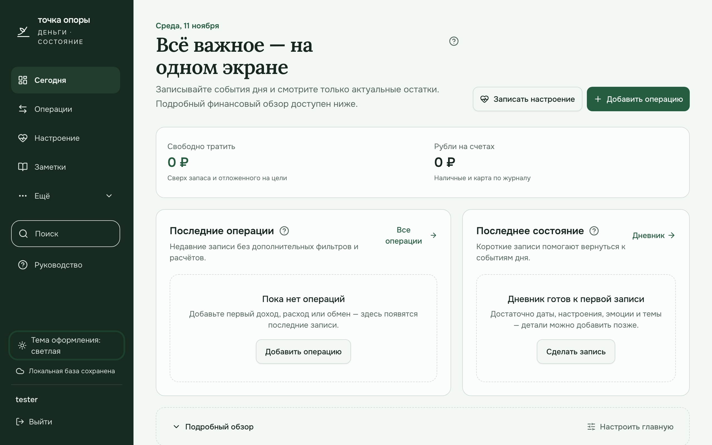
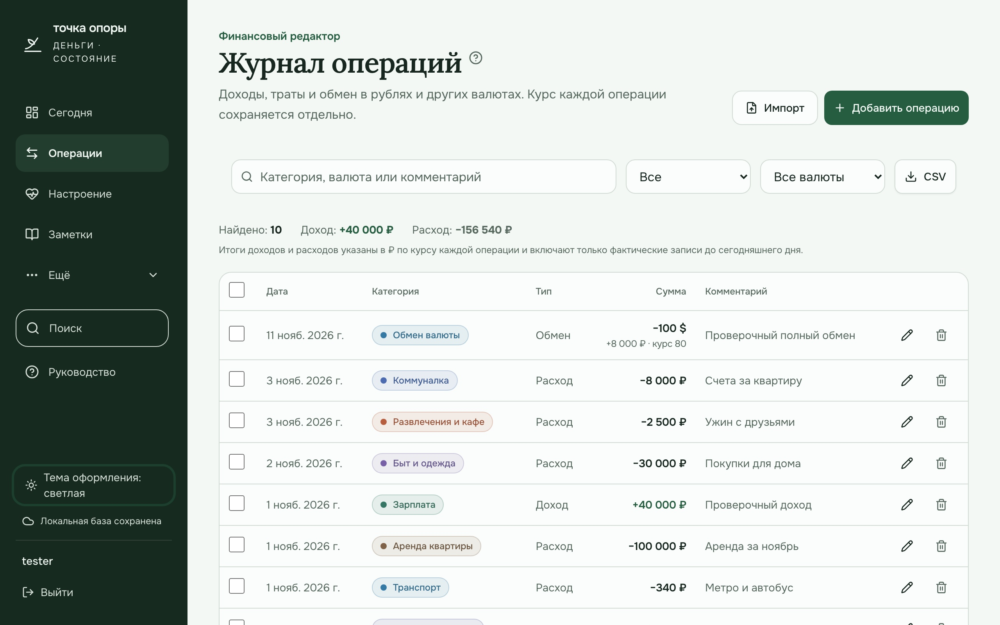
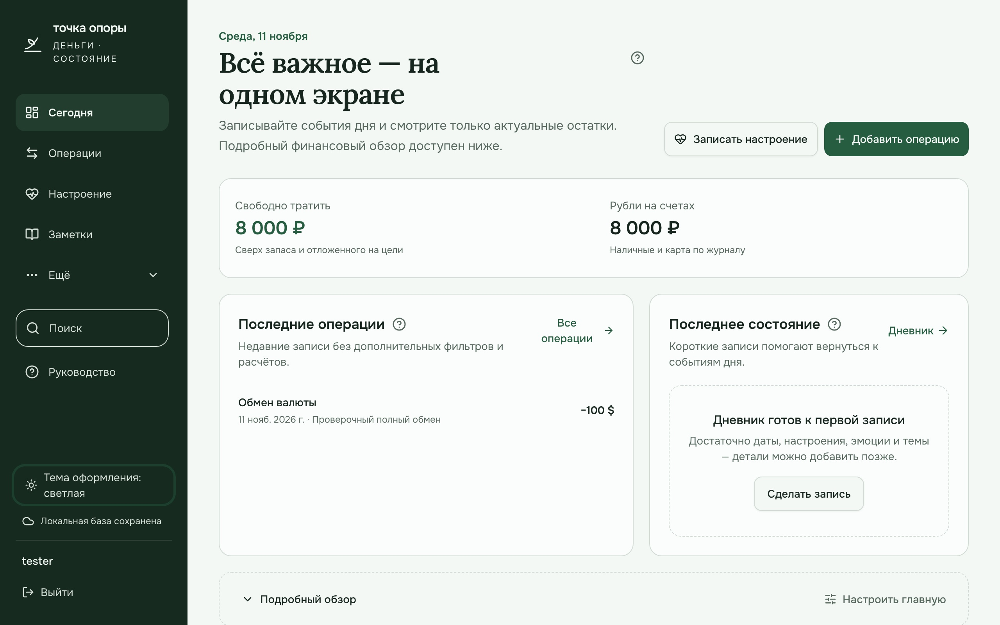
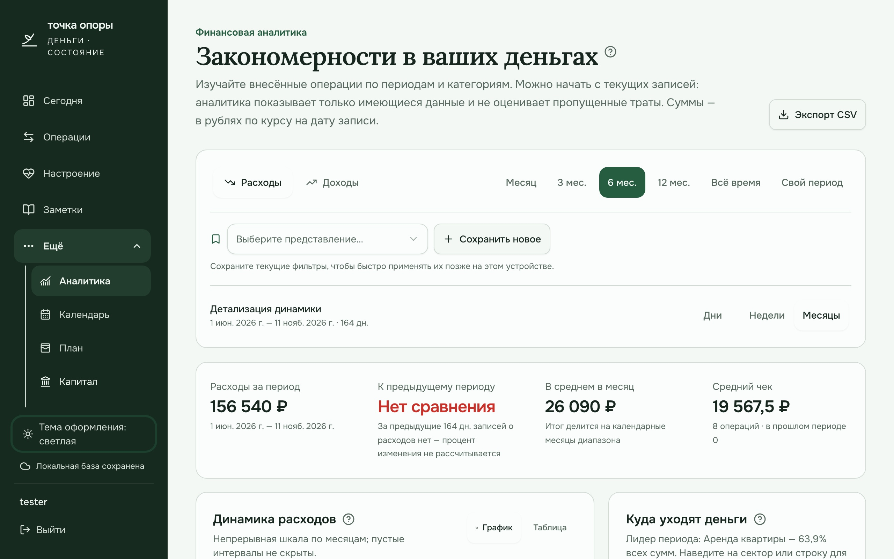
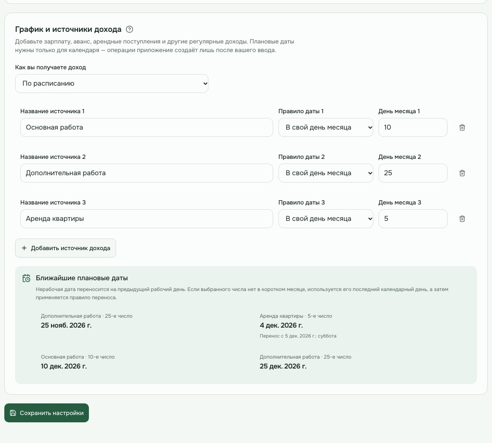
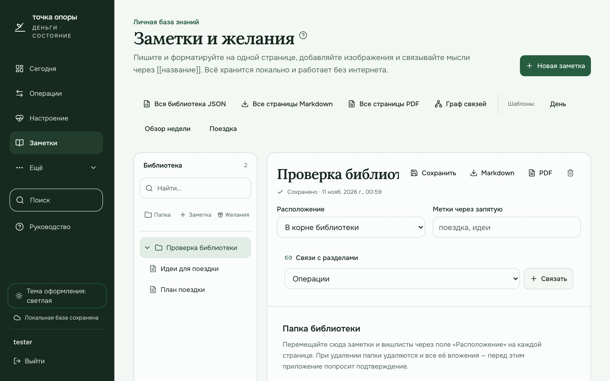
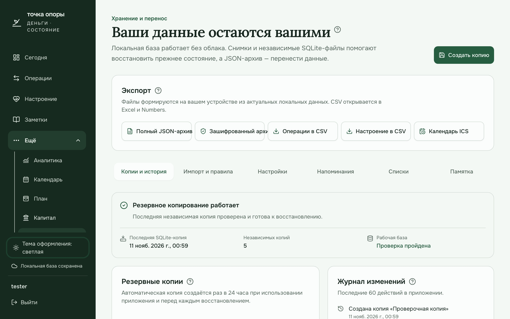

# Руководство по «Точке опоры»

«Точка опоры» объединяет деньги, состояние и заметки, но **не требует пользоваться всеми разделами сразу**. Все иллюстрации ниже содержат только обобщённые демонстрационные записи.

## Быстрый старт

После первой регистрации приложение предложит шесть коротких карточек. Их можно пройти, пропустить или закрыть — это никак не влияет на данные. Позже руководство открывается кнопкой **«Руководство»** на компьютере и через **«Ещё» → «Открыть руководство»** на телефоне.

Во встроенном руководстве нажмите **«Увеличить изображение»**, чтобы открыть снимок отдельно. При 100 % весь снимок автоматически вписывается в доступную область экрана без обрезания. Кнопки **«Приблизить»** и **«Уменьшить»** меняют масштаб от 100 до 300 %, **«По размеру экрана»** возвращает полный обзор, а увеличенное изображение можно прокручивать. На компьютере также работают клавиши `+`, `−`, `0` и Ctrl/⌘ + колесо; Escape закрывает просмотр. Все иллюстрации сохранены в разрешении 2560 × 1600 и автоматически соответствуют светлой или тёмной теме приложения, включая режим системной темы.

Минимальный рабочий сценарий:

1. В **«Данные» → «Настройки»** один раз указать текущие остатки и дату начала учёта.
2. Добавлять доходы, расходы и обмены в **«Операции»**.
3. Смотреть актуальные остатки и последние записи на **«Сегодня»**.
4. По желанию записывать настроение и вести заметки.
5. Периодически сохранять резервную копию на другом носителе.

Конверты, цели, регулярные платежи, капитал, длительная аналитика и импорт старой истории решают отдельные задачи. Подключайте их постепенно — для начала достаточно остатков и журнала операций.



## Карта разделов

| Раздел | Зачем нужен | Что использует | Если не пользоваться |
| --- | --- | --- | --- |
| **Сегодня** | Быстро увидеть доступные деньги, последние операции и состояние | Остатки, операции, настроение, настройки плана | Записи остаются доступны в своих разделах |
| **Операции** | Хранить фактические доходы, расходы и обмены | Ручной ввод, CSV/OFX, локальный API | Без новых записей остатки не отражают текущие события |
| **Настроение** | Наблюдать за состоянием, сном, энергией и повторяющимися темами | Записи дневника | Финансовый учёт продолжает работать |
| **Заметки** | Хранить дерево страниц, изображения, связи и вишлисты | Собственные заметки и вложения | Не влияет на деньги и дневник |
| **Аналитика** | Изучать внесённые операции по периодам и категориям | Журнал операций | Новые записи и остатки продолжают работать |
| **Календарь** | Увидеть операции и плановые события по датам | Операции, платежи, зарплатные правила | Не изменяет данные |
| **План** | Оценивать обязательства, лимиты, цели и запас | Платежи, конверты, цели, остатки и операции | Можно просто вести журнал без прогнозов |
| **Капитал** | Вести ручной снимок имущества и долгов | Вручную введённые оценки | Не влияет на ежедневный учёт |
| **Данные** | Настраивать приложение, импортировать, экспортировать и защищать данные | Вся локальная база | Не требуется для каждодневных действий, но нужен для копий |

## Подсказки рядом с функциями

У заголовков страниц и крупных блоков находится значок вопроса. Наведите на него указатель или нажмите: откроется практическая инструкция о порядке действий, доступных элементах управления и последствиях. С клавиатуры перейдите к значку клавишей Tab, затем нажмите Enter или пробел. Подсказка не повторяет описание под заголовком. Например, в календаре настроения она объясняет, как выбрать день, отфильтровать записи и вернуться ко всем датам. Закрыть подсказку можно клавишей Escape или нажатием вне неё.

Если значки больше не нужны, откройте **«Данные» → «Настройки» → «Помощь в интерфейсе»** и выключите **«Контекстные подсказки»**. Выбор сохраняется в текущем браузере и сразу действует на всех страницах. Полное руководство при этом остаётся доступным, а сами функции не отключаются.

## Практические сценарии

### Добавить расход или доход

1. Откройте **«Операции»** и нажмите **«Добавить операцию»** либо используйте быстрое действие на **«Сегодня»**.
2. Выберите тип, дату, категорию, валюту и сумму. Для иностранной валюты проверьте курс к рублю: он сохраняется вместе с записью.
3. Добавьте комментарий, если он поможет узнать событие позже, и сохраните операцию.
4. Проверьте запись в журнале и изменённый остаток на главной. Операцию можно отредактировать, а комментарий и категорию — использовать для поиска.

Дата в будущем делает запись плановой: она появится в календаре и прогнозе, но не изменит доступный сегодня остаток.

При подключении телефона к компьютеру по локальному HTTP добавление операций работает и в браузерах без `crypto.randomUUID`: приложение использует совместимый генератор идентификаторов. Это же относится к заметкам, элементам вишлиста, напоминаниям и сохранённым представлениям аналитики.

### Обменять валюту

1. В новой операции выберите тип **«Обмен»**.
2. Укажите валюту и сумму продажи, затем валюту и сумму покупки.
3. Сохраните обмен и проверьте оба остатка. Если иностранная валюта полностью обменяна, её плашка на главной скрывается, но история обмена остаётся в журнале.

### Импортировать банковскую историю

1. Откройте **«Данные» → «Импорт и правила»** и выберите CSV, OFX или QFX.
2. Сопоставьте столбцы и проверьте предпросмотр. Ошибки показываются по строкам, повторяющиеся операции не добавляются.
3. Подтвердите пакет. Перед записью приложение создаёт снимок данных.
4. При неверном результате откатите именно этот пакет: остальные операции останутся на месте. Правила категорий помогают автоматизировать следующие импорты без выполнения чужого кода.

### Разобрать категорию расходов

1. В **«Аналитике»** выберите **«Расходы»**, нужный диапазон и группировку.
2. Нажмите на строку категории: откроются её динамика, суммы и исходные операции.
3. Сравнение с предыдущим периодом использует равный по длине диапазон. Если там нет записей, приложение показывает **«Нет сравнения»**, а не выдумывает процент.
4. Сохраните представление, чтобы вернуться к тем же фильтрам. Позже его можно переименовать, обновить, откатить или удалить без изменения операций.

### Настроить план без лишних правил

1. В **«План»** добавьте только известные регулярные платежи. Это напоминания и расчётные обязательства, а не автоматические списания.
2. Для повседневных категорий задайте конверты с месячными лимитами. Деньги остаются в общем остатке; лимит помогает сопоставить план и факт.
3. Добавьте цель или запас, если хотите видеть ориентир накоплений. Все суммы «уже отложено» вводятся вручную и не создают банковских переводов.
4. Фактический расход по-прежнему вносится через **«Операции»**. Журнал можно вести и вовсе без плана.

### Записать состояние

1. Откройте **«Настроение»** и используйте быструю отметку или подробную форму.
2. Для подробной записи достаточно даты, оценки, эмоции и темы. Поля сна, энергии, мыслей и наблюдений заполняйте тогда, когда они действительно полезны.
3. В календаре и графиках смотрите на серию наблюдений, а не на одну отметку. Совместные изменения сна, энергии и настроения не доказывают причинную связь.

### Создать связанные заметки и вишлист

1. В **«Заметки»** создайте страницу и при необходимости выберите родительскую — так формируется дерево.
2. Форматируйте текст прямо в редакторе, добавляйте изображения и ссылки на другие страницы через `[[название]]`.
3. Для желания используйте шаблон вишлиста: сохраните название, цену и ссылку. Покупка становится расходом только после отдельной операции.
4. Экспортируйте страницу, когда нужно поделиться ею. Локальный граф показывает связи только внутри вашей библиотеки.

### Защитить и перенести данные

1. В **«Данные» → «Копии и история»** создайте ручной снимок или независимую SQLite-копию.
2. Скачайте полный JSON-архив на другой носитель. Для дополнительной защиты используйте зашифрованный архив и сохраните его пароль отдельно: без пароля восстановить содержимое невозможно.
3. Перед восстановлением приложение сохраняет текущее состояние. Проверяйте название и дату выбранной копии, потому что восстановление заменяет рабочие данные содержимым архива.

## Операции и остатки

Операция фиксирует событие: доход, расход или обмен. Журнал — источник фактических финансовых записей; аналитика и конверты лишь используют его.

В операции сохраняются дата, тип, категория, исходная валюта и сумма, курс к рублю, рублёвый эквивалент, комментарий и источник.

- Будущая операция считается запланированной и не меняет текущий остаток.
- Обмен одновременно меняет рублёвый и валютный остатки, но не считается доходом или расходом.
- Иностранная валюта показывается на главной только при положительном фактическом остатке.
- Стартовые остатки и дата начала учёта находятся в **«Данные» → «Настройки»**.

В журнале есть один основной поиск по категории, валюте и комментарию, фильтры типа и валюты, а также выгрузка CSV. Общий поиск в верхнем меню помогает переходить между разными записями и разделами.



Журнал влияет на остатки, последние записи на «Сегодня», аналитику, календарь, выполнение лимитов конвертов и сверку фактических денег с расчётным остатком.

## Сегодня

Главная страница нужна для ежедневных действий: добавить операцию, записать настроение, увидеть основные остатки и последние записи. Подробные блоки раскрываются отдельно, поэтому стартовый экран не требует изучения всех функций сразу.



## Как начать без полной старой истории

В настройках задаются стартовая дата и остатки на неё. Операции начиная с этой даты изменяют расчётный баланс. Более ранние записи могут остаться историей и участвовать в аналитике, но для ежедневной работы достаточно текущих остатков и новых событий.

**Можно начать с сегодняшнего фактического остатка и вносить только новые события.**

### Что означает «Нет сравнения»

Показатель «К предыдущему периоду» сравнивает два равных по длине диапазона. Если в предыдущем диапазоне нет внесённых доходов или расходов, процент изменения вычислить нельзя. Это не ошибка базы и не требование заполнить прошлый период.

Приложение не может отличить реальное отсутствие событий от незаполненной истории. Поэтому графики остаются корректными **по имеющимся записям**, но не описывают неизвестные события и не подставляют средние значения.

## Аналитика и сохранённые представления

Аналитика отвечает на вопросы:

- сколько записано доходов или расходов за выбранный диапазон;
- какие категории занимают большую долю;
- как меняются суммы по дням, неделям и месяцам;
- из каких операций состоит категория;
- как выглядит сценарий остатка при известных будущих событиях.

Обмены и будущие операции исключены из анализа доходов и расходов. Прогноз — сценарий по известным данным, а не гарантия.

Сохранённое представление запоминает фильтры аналитики. Его можно применить, переименовать, обновить текущими фильтрами, откатить к последнему сохранённому состоянию или удалить. Удаление представления не удаляет операции.



## План — только если нужен прогноз

### Регулярные платежи

Платёж описывает план, а не автоматическое списание. Фактический расход появляется через операцию. Если платёж уже внесён как расход в этом месяце, приложение старается не зарезервировать его повторно.

### Конверты

**Конверт — это месячный ориентир или лимит по категории расходов, а не отдельный счёт.**

Например, конверт «Еда» с лимитом 15 000 ₽ не переносит деньги в отдельное место. Он сопоставляет расходы категории «Еда» с лимитом и показывает потраченную и оставшуюся часть плана.

- Деньги остаются в общем остатке.
- Конверт не создаёт операции и не запрещает трату.
- Пустая сумма означает «план не задан», а не нулевой бюджет.
- Журнал, остатки и аналитика работают без конвертов.

### Цели и запас

Сумма «уже отложено» вводится вручную и уменьшает оценку свободных денег, но не создаёт банковский перевод. Неприкосновенный запас — расчётная цель резерва, а не отдельный счёт.

### Кошелёк и сверка

Сверка сравнивает фактически насчитанные деньги с расчётом журнала и сохраняет снимок расхождения. Она не исправляет остаток автоматически и не удаляет историю.

## Календарь

Календарь показывает операции в датах, регулярные платежи и плановые зарплатные даты. Плановое событие отличается от фактического и не становится доходом или расходом само по себе.

График настраивается в **«Данные» → «Настройки» → «График дохода»**. Доступны две выплаты с независимыми днями, одна выплата в месяц или доход по факту. В режиме двух выплат вторую можно оставить в последний рабочий день. Дни 29–31 безопасно сокращаются до конца короткого месяца, а нерабочая дата переносится на предыдущий рабочий день.

Тип выплат и их дни можно менять в любой момент. Предпросмотр ближайших дат обновляется сразу; после нажатия **«Сохранить настройки»** перестраиваются главная, календарь и связанные прогнозы. Уже внесённые доходы и расходы не переносятся, не пересчитываются по новым датам и не удаляются. При возврате к регулярному графику можно снова использовать сохранённые дни.

Для ежедневной, сдельной или нерегулярной оплаты выберите **«Ежедневно, сдельно или нерегулярно»**. Тогда приложение не создаёт плановых дат и не показывает обратный отсчёт или прогноз «до зарплаты». Каждое поступление вносится в журнал по факту; запас, платежи и аналитика продолжают работать.



## Капитал

Раздел отвечает на вопрос **«Чем я владею и сколько должен по ручной оценке?»**. Активы и обязательства вводятся вручную, котировки не обновляются онлайн, оценка не создаёт операции. Капитал не следует путать с деньгами, доступными сегодня.

## Настроение

Для записи достаточно даты, настроения, эмоции и темы. Сведения о сне, энергии и дополнительные наблюдения добавляйте тогда, когда они полезны. Графики и совместные изменения не доказывают причинную связь и не ставят диагнозы. Деньги не определяют настроение автоматически.

## Заметки и вишлисты

Заметки образуют личную базу знаний: папки, страницы, форматирование, изображения, связи `[[название]]`, граф и экспорт.

Вишлист — структурированная заметка для желаний, цен и ссылок. Цена в вишлисте не становится расходом: покупка вносится отдельной операцией только тогда, когда она произошла.



## Данные, копии и безопасность

- **Копии и история:** автоматические и ручные снимки, восстановление, журнал действий.
- **Импорт и правила:** CSV/OFX, предпросмотр, дедупликация, откат пакета, правила категорий.
- **Настройки:** стартовые остатки, валюты, параметры плана, контекстные подсказки, локальная учётная запись и API-токены.
- **Напоминания:** разовые и повторяющиеся события, экспорт ICS.
- **Списки:** собственные варианты эмоций, тем и времени суток.

Резервные копии на том же диске не заменяют внешнюю копию. Для независимой защиты нужен скачанный архив на другом носителе.



## Обновление приложения

Рекомендуемый способ — распаковать новую версию **рядом со старой папкой** и остановить старый сервер. При первом запуске новая установка ищет одну однозначно подходящую соседнюю папку «Точки опоры» с локальной базой.

Если такая папка одна и в новой установке ещё нет базы, приложение:

1. проверяет исходную SQLite-базу;
2. создаёт согласованную копию и переносит дополнительные данные;
3. повторно проверяет целостность;
4. только затем открывает перенесённые данные.

Старая папка не изменяется. Существующая база новой установки никогда не перезаписывается. Явно заданный `DATA_DIR` отключает поиск соседних установок.

Если подходящих папок несколько или база повреждена, запуск останавливается с инструкцией вместо выбора случайных данных. Универсальный запасной способ — создать полный JSON-архив в старой версии и восстановить его через **«Данные»** в новой.

После смены версии один раз появляется окно **«Что нового»**. Оно не удаляет записи и не запускает первичное обучение заново.

Подробности и восстановление вручную: [Установка и обновление](INSTALL.md#обновление-без-потери-данных).

## Как всё связано

```text
Стартовые остатки + операции
            ↓
   Расчётные остатки по валютам
            ↓
 ┌──────────┼───────────┬─────────────┐
Сегодня   Аналитика   Календарь   Сверка кошелька

Платежи + конверты + цели + настройки запаса
            ↓
      План и оценка свободных денег

Записи настроения → дневник и наблюдения за состоянием
Заметки и вишлисты → личная база знаний
Капитал → отдельный ручной снимок имущества и долгов
Все данные → экспорт, архивы и резервные копии
```

Главный принцип: **сначала ежедневная польза с минимумом ввода, затем дополнительные возможности по мере необходимости**. Неполная старая история и работа без конвертов — нормальные способы пользоваться приложением, а не ошибка.
