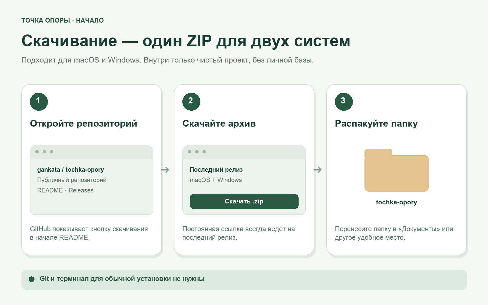
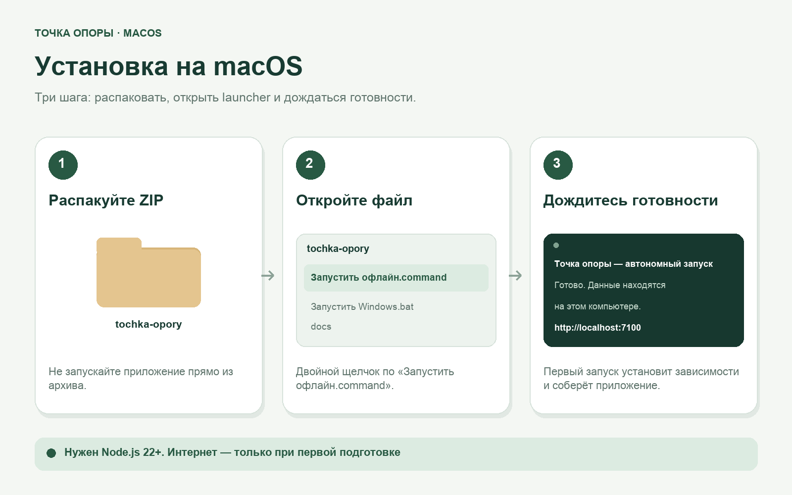
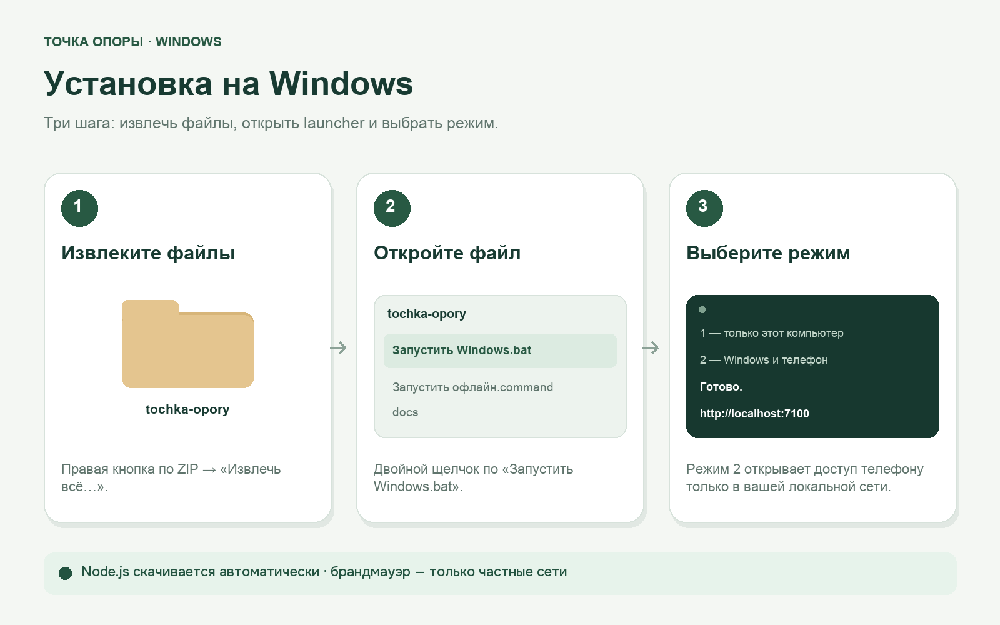

# Установка и обновление

Это руководство предназначено для обычного запуска «Точки опоры» без Git и команд в терминале.

Иллюстрации ниже схематично показывают шаги и не являются снимками чужого компьютера. Названия кнопок и оформление окон могут немного отличаться в зависимости от версии системы.

## 1. Скачайте и подготовьте приложение

**[Скачать последнюю версию (.zip)](https://github.com/gankata/tochka-opory/releases/latest/download/tochka-opory.zip)**



Перед первым запуском:

1. Установите [Node.js 22 или новее](https://nodejs.org/) с параметрами установщика по умолчанию.
2. Распакуйте архив в обычную папку, например «Документы/tochka-opory». Не запускайте файлы прямо из ZIP.
3. Подключитесь к интернету: первый launcher выполнит `npm ci` и production-сборку автоматически.

После первой подготовки интернет не нужен. Ваши записи появятся в папке `data/` внутри установленного приложения; в скачанном архиве чужих данных нет.

## macOS



1. Откройте скачанный ZIP двойным щелчком. Рядом появится папка `tochka-opory`.
2. Перенесите папку в удобное постоянное место, например в «Документы».
3. Откройте `Запустить офлайн.command` двойным щелчком.
4. Выберите режим:
   - **1 — только этот компьютер:** `http://localhost:7100`;
   - **2 — компьютер и телефон:** дополнительно появится локальный адрес для телефона.
5. При первом запуске дождитесь установки зависимостей и сборки. Не закрывайте окно сервера во время работы.

Если macOS не открывает launcher после скачивания, нажмите по нему правой кнопкой и выберите «Открыть». Запускайте только файл из официального репозитория проекта.

Остановка сервера — `Ctrl+C` в окне запуска. Если порт 7100 занят, launcher автоматически выберет следующий свободный до 7199.

## Windows



1. Нажмите по скачанному ZIP правой кнопкой и выберите «Извлечь всё…».
2. Перенесите распакованную папку в удобное постоянное место, например `Документы\tochka-opory`.
3. Откройте `Запустить Windows.bat` двойным щелчком.
4. Выберите режим:
   - **1 — только Windows:** `http://localhost:7100`;
   - **2 — Windows и телефон:** дополнительно появится локальный адрес для телефона.
5. При первом запуске дождитесь установки зависимостей и сборки. Не закрывайте окно сервера во время работы.

Если Windows спросит про брандмауэр, разрешайте Node.js **только в частных сетях**. Не разрешайте доступ в публичных сетях и не открывайте порт через роутер.

Остановка сервера — `Ctrl+C` в окне запуска. Если порт 7100 занят, launcher автоматически выберет следующий свободный до 7199.

## Первый вход

1. Откройте адрес из окна запуска.
2. Создайте локальный логин и уникальный пароль длиной не менее 10 символов.
3. Используйте ту же учётную запись на телефоне.

Пароль хранится только как scrypt-хеш. Если вы его забыли, остановите сервер, откройте терминал в папке проекта и выполните:

```bash
npm run auth:reset
```

Команда дважды запросит новый пароль, не показывая ввод, и завершит старые сессии. Права root не нужны.

## Обновление без потери данных

Не удаляйте прежнюю папку, пока не проверите записи в новой версии.

### Автоматический перенос из соседней папки

1. В прежнем приложении откройте «Данные» и создайте полный JSON-архив. Для дополнительной защиты сохраните его на другом носителе.
2. Остановите сервер прежней версии.
3. Скачайте новый релиз и распакуйте его в **отдельную новую папку рядом с прежней установкой**.
4. Запустите новую версию. Если рядом есть ровно одна подходящая прежняя установка и в новой ещё нет базы, приложение само создаст согласованную SQLite-копию, перенесёт дополнительные данные и проверит целостность.
5. Войдите с прежними локальными логином и паролем. Проверьте операции, настроение, заметки, изображения и настройки. Только после этого можно удалить старую установку.

Прежняя папка не изменяется и остаётся дополнительной резервной копией. Существующая база новой установки никогда не перезаписывается. Явно заданный `DATA_DIR` отключает автоматический поиск.

Если подходящих прежних папок несколько, приложение остановит запуск и покажет инструкцию вместо случайного выбора. Оставьте рядом только нужную прежнюю установку либо воспользуйтесь JSON-архивом. Повреждённая база также не будет заменена чистой: сначала восстановите её резервную копию.

### Универсальный перенос через JSON-архив

Этот способ подходит при нескольких установках, переносе на другой компьютер или распаковке в другом месте:

1. В прежнем приложении откройте «Данные» и создайте полный JSON-архив.
2. Установите и запустите новую версию, не перенося соседнюю базу автоматически.
3. Восстановите полный JSON-архив через раздел «Данные».
4. Проверьте все записи и настройки перед удалением прежней установки.

Папку `data/` нельзя заменять во время работы сервера. После смены версии приложение один раз покажет окно «Что нового»; полное описание функций доступно в кнопке «Руководство» и в [публичном руководстве](GUIDE.md).

## Если что-то не запускается

- Проверьте, что Node.js версии 22 или новее установлен и компьютер после установки был перезапущен, если этого потребовал установщик.
- Убедитесь, что проект распакован, а не открыт внутри ZIP.
- При первом запуске проверьте интернет и дождитесь завершения `npm ci` и сборки.
- Откройте `http://127.0.0.1:7100/api/health`. Если launcher выбрал другой порт, используйте адрес из его окна.
- Для подключения телефона используйте режим 2 и одну Wi-Fi-сеть без гостевой изоляции. [Подробное решение сетевых проблем](WINDOWS-ANDROID.md).

Локальный HTTP не шифрует трафик. Используйте его только в собственной сети и не публикуйте сервер в интернете.
